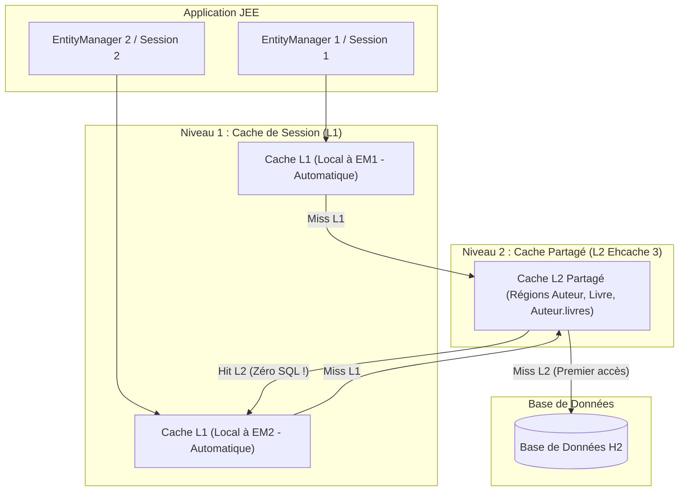
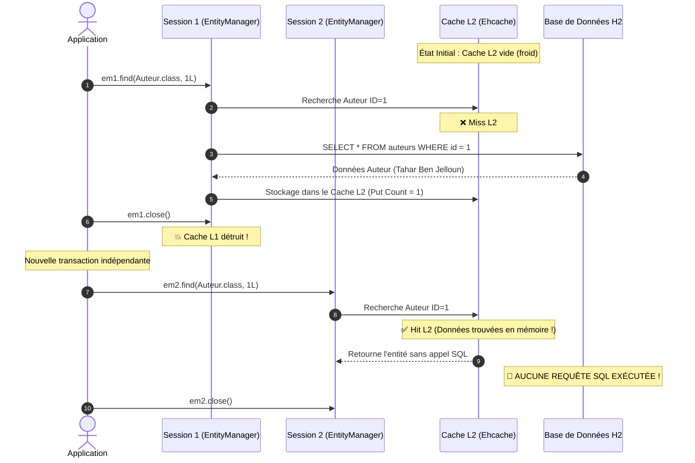

# TP JPA & Hibernate : Cache de Second Niveau (Ehcache 3) et Résolution du Problème N+1

> **Application :** Bibliothèque Numérique & Maison d'Édition  
> **Auteure :** Houda El Amrani  
> **Technologies :** Java, JPA 2.2, Hibernate 5.6, Ehcache 3.10 (JSR-107 JCache), Base H2 In-Memory, Maven  

---

## 🎯 Objectifs d'apprentissage

1. **Identifier et diagnostiquer le problème N+1 requêtes** généré par le chargement différé (*LAZY Loading*) des associations JPA.
2. **Éliminer le N+1 via la clause JPQL `JOIN FETCH`** en chargeant les entités et leurs collections en une requête SQL unique.
3. **Mettre en œuvre les JPA Entity Graphs (`@NamedEntityGraph`)** pour contrôler le chargement de manière déclarative et dynamique sans modifier les requêtes JPQL.
4. **Configurer et activer le Cache de Second Niveau (*L2 Cache*) avec Ehcache 3 (JCache / JSR-107)** pour partager les entités et collections entre plusieurs sessions distinctes.
5. **Comprendre le piège du cache des collections :** Découvrir pourquoi `@Cache` doit être annoté à la fois sur l'entité et sur le champ de la collection (`List<Livre>`).
6. **Analyser les métriques de performance et les statistiques officielles Hibernate** (`Hits`, `Misses`, `Puts`).

---

## 🏛️ Modèle Relationnel

```text
+------------------------------------+          +------------------------------------+
|               Auteur               | 1      * |               Livre                |
+------------------------------------+----------+------------------------------------+
| - id : Long [PK]                   |          | - id : Long [PK]                   |
| - nom : String                     |          | - titre : String                   |
| - nationalite : String             |          | - isbn : String                    |
| - biographie : String              |          | - anneePublication : int           |
| - livres : List<Livre> [@Cache]    |          | - prix : double                    |
+------------------------------------+          | - auteur : Auteur [FK, LAZY]       |
                                                +------------------------------------+
```

---

## 🔍 Analyse Comparative : Les 3 Approches face au Problème N+1

| Approche | Requêtes SQL exécutées | Doublons possibles ? | Modification du JPQL requise ? | Idéal pour... |
|---|---|---|---|---|
| **Sans Optimisation (N+1)** | **1 + N** *(11 requêtes pour 10 auteurs)* | Non | Non | À proscrire en production |
| **`JOIN FETCH`** | **1 seule requête** | Oui *(résolu avec `DISTINCT`)* | Oui | Requêtes spécifiques rapides |
| **`JPA Entity Graph`** | **1 seule requête** | Géré proprement | **Non** *(via hint déclaratif)* | Architecture propre & réutilisable |

---

## ⚡ Architecture des Niveaux de Cache dans Hibernate



---

## 🔄 Déroulement Temporel du Cache L2 entre Sessions



---

## 🚀 Guide d'Exécution

### 1. Lancer la Suite de Tests Unitaires JUnit 4
```powershell
mvn test
```

### 2. Lancer la Démonstration Complète du TP
```powershell
mvn compile exec:java
```

Ou double-cliquez directement sur [`run.bat`](run.bat).
